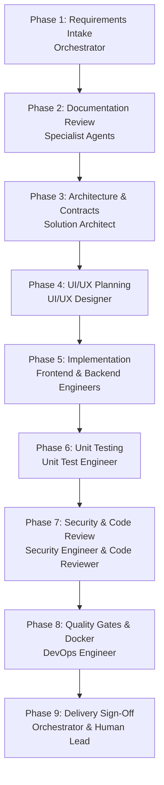

# Workflow: Feature Delivery

This workflow defines the mandatory nine-phase lifecycle for introducing any new feature into the repository.

## Phase 1: Requirements Intake

- **Agent**: Orchestrator
- **Action**: Clarify user goals, define scope, boundary conditions, and acceptance criteria.
- **Output**: Task definition using `.agents/templates/task.md`.

## Phase 2: Documentation Review

- **Agent**: Relevant Specialist Agents (Architect, Frontend, Backend)
- **Action**: Read installed Next.js documentation (`node_modules/next/dist/docs/`) and official reference guides for the feature's technology stack.
- **Output**: Verified API compatibility notes and references.

## Phase 3: Architecture & Contracts

- **Agent**: Solution Architect
- **Action**: Design module boundaries, Server/Client separation, DTO interfaces, and ADRs when significant changes occur.
- **Output**: Interface contracts and `docs/decisions/XXXX-*.md`.

## Phase 4: UI/UX Planning

- **Agent**: UI/UX Designer
- **Action**: Define component tokens, responsive layouts, focus styling, and accessibility states (loading, empty, error, success).
- **Output**: UI component specifications and layout tokens.

## Phase 5: Implementation

- **Agent**: Frontend & Backend Engineers
- **Action**: Build components, Server Actions, Route Handlers, and domain services according to contracts. Ensure `server-only` protection on sensitive logic.
- **Output**: Source code in `src/`.

## Phase 6: Unit Testing

- **Agent**: Unit Test Engineer
- **Action**: Write isolated, fast unit tests with positive, negative, and boundary scenarios. Mock external systems.
- **Output**: Unit test suites (`*.test.ts`, `*.test.tsx`) passing in under 5 seconds.

## Phase 7: Security & Code Review

- **Agent**: Security Engineer & Code Reviewer
- **Action**: Audit code for OWASP compliance, zero-trust boundaries, absence of leaked secrets, and strict coding standards.
- **Output**: Review sign-off and remediation notes.

## Phase 8: Quality Gates & Docker Verification

- **Agent**: DevOps Engineer
- **Action**: Execute `pnpm typecheck`, `pnpm lint`, `pnpm format:check`, `pnpm test`, and `pnpm build`. Verify Docker container builds cleanly and excludes development assets.
- **Output**: Green quality gate summary.

## Phase 9: Delivery Sign-Off

- **Agent**: Orchestrator & Human Lead
- **Action**: Compile final delivery summary, list verified vs. deferred scope, and present results for human sign-off.
- **Output**: Delivery report and release tag readiness.
