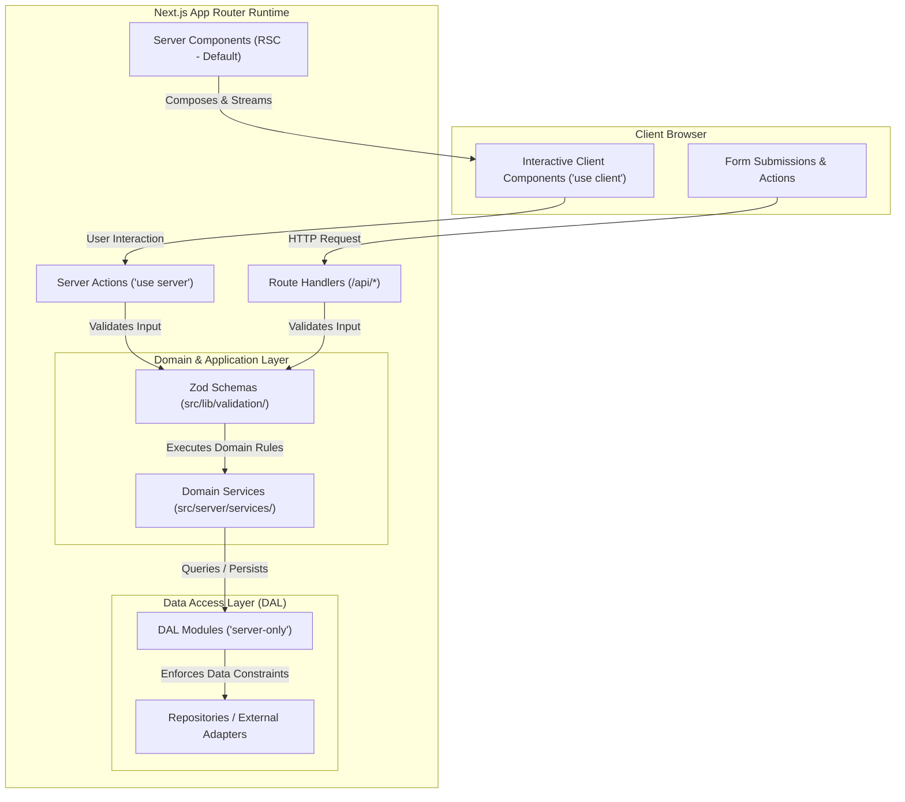

# Architecture Specification

## 1. System Overview

This Next.js application scaffold is designed as a modular, production-ready foundation for modern web applications, SaaS products, dashboards, and enterprise portals. It follows the **Next.js App Router** paradigm, emphasizing Server Components by default, localized Client Components, clear boundary contracts, and strict separation between development systems and the runtime environment.



## 2. Strict Separation of AI Agent System and Runtime

A foundational architectural requirement of this project is the **absolute isolation** of development-time AI engineering resources from production application runtime:

1. **Development-Only Directory Boundary**:
   - All agent instructions, roles, workflows, and templates are located exclusively in `.agents/`, `AGENTS.md`, and `CLAUDE.md` in the repository root.
   - Application source code resides exclusively in `src/` and `public/`.
   - Application code is forbidden from importing, referencing, or bundling any resource from `.agents/`.

2. **Docker Build Isolation**:
   - `.dockerignore` explicitly excludes `.agents/`, `AGENTS.md`, `CLAUDE.md`, and task logs from the Docker build context.
   - The multi-stage `Dockerfile` only copies production build output (`.next/standalone`, `.next/static`, and `public`), completely preventing development artifacts from ever existing in runtime layers.

3. **Output File Tracing Verification**:
   - Next.js output file tracing (`output: 'standalone'`) traces runtime dependencies from `src/`. Because no runtime file imports `.agents/`, the resulting `.next/standalone/` folder contains only needed production code.

## 3. Layered Module Architecture

The application is structured into clearly delineated responsibility layers:

### A. Presentation Layer (`src/app/`, `src/components/`)

- **Server Components (Default)**: Fetch data server-side, render semantic HTML, stream via Suspense, and pass serialized DTOs to child components.
- **Client Components (`'use client'`)**: Confined strictly to leaf nodes requiring user interactivity, state (`useState`), or browser APIs.
- **Reusable UI Primitives (`src/components/ui/`)**: Accessible, headless-compatible components built with Tailwind CSS, `cva`, `clsx`, and `tailwind-merge`.
- **Layouts (`src/components/layout/`)**: Application shell, headers, navigation bars, and footers.

### B. Feature Modules (`src/features/`)

- Encapsulates feature-specific components, schemas, and Server Actions.
- Allows vertical slicing of business domains (e.g., `src/features/inquiry/`) while sharing foundational primitives from `src/components/ui/`.

### C. Application & Domain Services (`src/server/services/`)

- Contains pure business logic, calculations, and domain workflow coordination.
- Completely decoupled from Next.js HTTP request/response objects, allowing thorough, fast unit testing without web server mocking.

### D. Data Access Layer (`src/server/dal/`)

- Enforces `import 'server-only'` to guarantee that database access or protected internal operations cannot be bundled into client-side code.
- Encapsulates data fetching, authorization assertions, and query mapping into clean Data Transfer Objects (DTOs).

### E. Validation & Security (`src/lib/validation/`, `src/lib/security/`)

- Centralized Zod schemas validating all external inputs across Server Actions and Route Handlers.
- Standardized security headers, sanitization helpers, and API error formatting.

## 4. Error Handling & Response Contracts

All Route Handlers and Server Actions conform to a standard discriminated union contract:

```typescript
export type ActionResult<T> =
  | { success: true; data: T }
  | { success: false; error: { code: string; message: string; details?: unknown } };
```

This guarantees predictable error states for UI components and prevents unhandled internal exceptions or stack traces from reaching clients.
