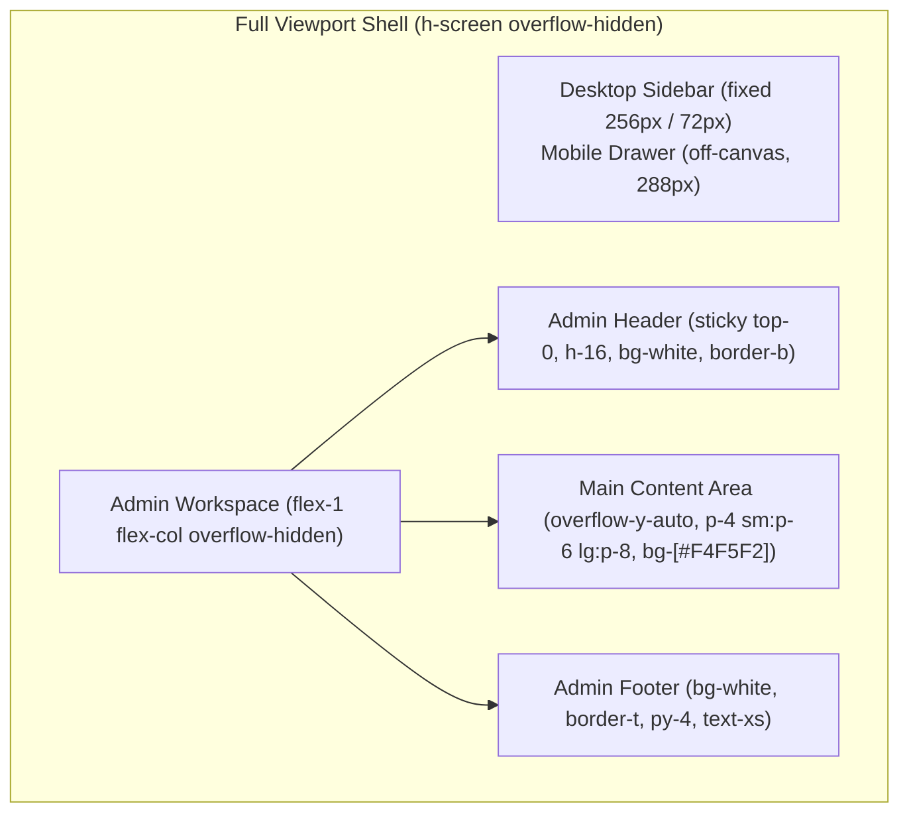

# Mandatory Frontend Design System & Visual Quality Guide

## 1. Overview & Visual Identity

This project adheres to a refined, contemporary SaaS administration workspace aesthetic characterized by editorial-inspired typography, restrained accents, intentional whitespace, and strict visual consistency.

A plain-text interface, unstyled HTML, or default browser elements constitute a **failed deliverable**. All UI components must ship with complete visual states, accessibility treatments, and responsive styling.

---

## 2. Color Palette & Semantic Design Tokens

All colors are defined as semantic CSS custom properties in `src/app/globals.css` and exposed to Tailwind CSS v4 via `@theme`. Arbitrary inline hexadecimal colors in JSX components are strictly forbidden.

| Token                         | Hex Value | CSS Custom Property    | Tailwind Token                               | Semantic Usage                                         |
| ----------------------------- | --------- | ---------------------- | -------------------------------------------- | ------------------------------------------------------ |
| **Sidebar Background**        | `#172632` | `--sidebar-bg`         | `bg-sidebar` / `bg-[#172632]`                | Fixed desktop sidebar & mobile navigation drawer       |
| **Sidebar Active Item**       | `#305B60` | `--sidebar-active`     | `bg-sidebar-active` / `bg-[#305B60]`         | Active navigation background surface                   |
| **Sidebar Primary Text**      | `#F4F7F6` | `--sidebar-text`       | `text-sidebar-text` / `text-[#F4F7F6]`       | Active item labels and brand headings                  |
| **Sidebar Muted Text**        | `#A3B5C0` | `--sidebar-text-muted` | `text-sidebar-muted` / `text-[#A3B5C0]`      | Inactive navigation links, group headings, icons       |
| **Main Background**           | `#F4F5F2` | `--main-bg`            | `bg-main` / `bg-[#F4F5F2]`                   | Application canvas and workspace background            |
| **Surface / Card Background** | `#FFFFFF` | `--surface-bg`         | `bg-surface` / `bg-[#FFFFFF]`                | Content cards, headers, popovers, footers              |
| **Primary Text**              | `#192E32` | `--text-primary`       | `text-primary` / `text-[#192E32]`            | Headings, card titles, high-contrast text              |
| **Secondary Text**            | `#758481` | `--text-secondary`     | `text-secondary` / `text-[#758481]`          | Subtitles, supporting copy, metadata, timestamps       |
| **Primary Accent**            | `#4B8881` | `--accent-primary`     | `bg-accent` / `text-accent` / `bg-[#4B8881]` | Brand marks, active indicators, primary buttons, chips |
| **Primary Accent Hover**      | `#386E69` | `--accent-hover`       | `hover:bg-[#386E69]`                         | Interactive button and link hover state                |
| **Border Color**              | `#DFE6E2` | `--border-color`       | `border-border` / `border-[#DFE6E2]`         | Subtle card dividers, header/footer borders            |

---

## 3. Typography Hierarchy

The typography system uses **Geist Sans** through the local Next.js font package (`geist/font/sans`), ensuring offline and containerized reliability.

| Hierarchy Level              | Font Size | Weight           | Line Height     | CSS / Tailwind Classes                                                |
| ---------------------------- | --------- | ---------------- | --------------- | --------------------------------------------------------------------- |
| **Main Page Heading**        | 28–32px   | Semibold (`600`) | Tight (`1.2`)   | `text-2xl sm:text-[28px] lg:text-[30px] font-semibold text-[#192E32]` |
| **Section Heading**          | 18–20px   | Semibold (`600`) | Tight (`1.25`)  | `text-lg sm:text-xl font-semibold text-[#192E32]`                     |
| **Component / Card Heading** | 14–16px   | Semibold (`600`) | Snug (`1.3`)    | `text-base font-semibold text-[#192E32]`                              |
| **Body Text**                | 14–16px   | Normal (`400`)   | Relaxed (`1.5`) | `text-sm sm:text-base text-[#192E32] leading-relaxed`                 |
| **Supporting / Metadata**    | 12–13px   | Medium (`500`)   | Normal (`1.4`)  | `text-xs text-[#758481]`                                              |
| **Navigation Group Title**   | 11–12px   | Semibold (`600`) | Snug (`1.2`)    | `text-xs font-semibold uppercase tracking-widest text-[#A3B5C0]`      |

---

## 4. Proportions, Radii & Spacing Scale

The layout adheres to a 4px increment spacing scale with standardized geometry:

- **Expanded Sidebar Width**: 256px (`w-64`)
- **Collapsed Sidebar Width**: 72px (`w-[72px]`)
- **Header Height**: 64px (`h-16`)
- **Card Border Radius**: 12px (`rounded-xl`)
- **Button Border Radius**: 8px (`rounded-lg`)
- **Desktop Content Padding**: 24–32px (`p-6` to `p-8`)
- **Mobile Content Padding**: 16px (`p-4`)
- **Card Padding**: 24px (`p-6`)
- **Shadows**: Minimal and purposeful (`shadow-xs` on cards, `shadow-lg` on popovers)
- **Focus Rings**: `focus-visible:outline-none focus-visible:ring-2 focus-visible:ring-[#4B8881] focus-visible:ring-offset-2`

---

## 5. Layout Architecture & Responsive Specifications



### Desktop Layout (>= 1024px)

- Fixed left navigation sidebar with smooth width transition (`256px` <-> `72px`).
- The right workspace column calculates `padding-left` via CSS property `--workspace-sidebar-width` (`256px` when expanded, `72px` when collapsed).
- Reduced-motion safe (`motion-reduce:transition-none`).

### Mobile Layout (< 1024px)

- Desktop sidebar is hidden (`hidden lg:flex`).
- The workspace `padding-left` is `0` on mobile viewports.
- The header displays an accessible hamburger toggle (`aria-label="Open navigation menu"`).
- Clicking toggle opens a sliding drawer dialog (`w-72 bg-[#172632]`) with backdrop overlay (`bg-[#172632]/60 backdrop-blur-sm`).
- Dismissible via Escape key, close button, backdrop click, or route navigation. Body scroll is locked while active.

---

## 6. Icon System Standards

Per project design rules, **SVG icons are strictly prohibited**:

- No inline `<svg>` elements.
- No Lucide React (`lucide-react`) icons.
- No Heroicons (`@heroicons/react`).
- No emoji interface icons.

### Supported Implementation

Icons are powered exclusively by **Font Awesome Free 7.x** CSS webfonts via the `AppIcon` component:

```tsx
import { AppIcon } from "@/components/ui/app-icon";

// Standard icon
<AppIcon name="chart-pie" size="md" />

// Accessible icon with screen reader label
<AppIcon name="bell" size="md" srLabel="Open notifications" />
```

- Allowed names are governed by the strict TypeScript union `IconName` in `src/components/ui/app-icon.tsx`.
- Decorative icons are automatically rendered with `aria-hidden="true"`.
- Webfont assets reside at `public/webfonts/` and are bundled directly in production.

---

## 7. Component Styling Specifications

### 7.1 Sidebar & Navigation

- **Brand**: Displayed at top (`h-16`, border-b `#192E32`). Features a 36×36px `#4B8881` shield icon, app title (`#F4F7F6`), and uppercase tagline (`#A3B5C0`).
- **Nav Items**:
  - Inactive: `text-[#A3B5C0] hover:bg-[#305B60]/40 hover:text-[#F4F7F6]`.
  - Active: `bg-[#305B60] text-[#F4F7F6]` with a 4px `#4B8881` vertical accent bar on the left.
  - Collapsed: centered icons, `title` attribute for native accessible tooltip.
- **Nav Groups**: Uppercase tracking-widest heading with chevron toggle button; auto-expands when child route is active.
- **Collapse Toggle**: Bottom-pinned button with `angle-left` / `angle-right` icon and `aria-expanded` state.

### 7.2 Header & Notifications

- **Title**: Dynamic, displaying the active route's primary title and descriptive subtitle from `routeTitleMap`.
- **Right Action**: Far-right notification bell icon button (`40×40px`, touch-friendly, hover: `bg-slate-100`).
- **Popover**: 320px wide, `rounded-xl`, `border-[#DFE6E2]`, `bg-[#FFFFFF]`, `shadow-lg`.
  - Includes modal header, close button, and empty state container reading **"No notifications yet."**.
  - Dismissible via Escape key, backdrop click, or close button.

### 7.3 Metric Cards

- 4-card grid on Overview page (`grid-cols-1 sm:grid-cols-2 xl:grid-cols-4 gap-5`).
- White surface (`bg-[#FFFFFF]`), `border-[#DFE6E2]`, `rounded-xl`, `p-6`.
- Large metric value (`text-3xl font-bold text-[#192E32]`).
- Trend indicator chips (e.g. `bg-[#4B8881]/10 text-[#4B8881]`).
- Labeled explicitly as demonstration data.

### 7.4 Under Construction Pages

- Centered 448px card (`rounded-xl border border-[#DFE6E2] bg-[#FFFFFF] px-8 py-10`).
- Circular icon container (`bg-[#4B8881]/10 text-[#4B8881]`).
- Route-specific title and explanatory copy.
- Primary return button: `bg-[#4B8881] hover:bg-[#386E69] text-white rounded-lg px-4 py-2.5 text-sm font-medium`.

---

## 8. Permanent Visual Quality Gate Checklist

Before claiming completion on any frontend feature, verify:

- [ ] **CSS Pipeline**: Webpack/Turbopack compiles PostCSS rules; production stylesheet is >= 30 KB with non-empty Tailwind rules.
- [ ] **Colors & Tokens**: Background `#F4F5F2`, sidebar `#172632`, active `#305B60`, accent `#4B8881`, border `#DFE6E2`. No default dark mode inversion.
- [ ] **Typography**: Geist Sans renders cleanly across desktop and mobile. Headings use 28–32px semibold hierarchy.
- [ ] **Icons**: All icons render via Font Awesome CSS webfonts; zero SVG markup or fallback missing glyphs.
- [ ] **Desktop States**:
  - Sidebar expanded: 256px wide, labels visible, active accent bar present.
  - Sidebar collapsed: 72px wide, labels hidden, tooltips accessible on hover/focus.
- [ ] **Mobile States**:
  - Screen width 390px: sidebar is hidden; hamburger icon is visible.
  - Hamburger click opens drawer overlay with close button.
  - Cards stack in single column without horizontal overflow.
- [ ] **Notifications Popover**: Opens on click; shows "No notifications yet."; closes via close button, outside click, and Escape key.
- [ ] **Routes Check**: `/dashboard`, `/dashboard/users`, `/dashboard/projects`, `/dashboard/settings` return HTTP 200 with matching dynamic titles.
- [ ] **Keyboard Navigation**: Skip-to-content link visible on focus; tab order logical; focus rings high contrast (`#4B8881`).

---

## 9. Multi-Agent Frontend Responsibilities

| Role                  | Core Design & Quality Responsibility                                                                                                               |
| --------------------- | -------------------------------------------------------------------------------------------------------------------------------------------------- |
| **UI/UX Designer**    | Owns `docs/design-system.md` and design tokens. Produces component specifications, defines interaction states, and audits visual hierarchy.        |
| **Frontend Engineer** | Implements designs with precision. Verifies PostCSS/Tailwind build pipeline. Enforces leaf Client Components. Never delivers unstyled HTML.        |
| **Code Reviewer**     | Audits visual consistency, typography, responsive behavior, accessibility, and icon conformity. Blocks PRs with missing styling or broken layouts. |
| **Orchestrator**      | Enforces the 10-step Frontend Quality Workflow. Rejects technically functional deliverables if they are visually incomplete or unstyled.           |
