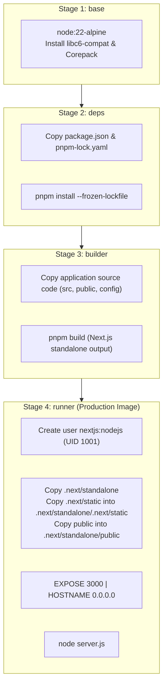

# Docker Architecture & Containerization Guide

## 1. Overview & Objectives

This project utilizes a hardened, multi-stage Docker build optimized for Next.js App Router standalone deployments. It complies with official Next.js self-hosting recommendations (`node_modules/next/dist/docs/01-app/02-guides/self-hosting.md`).

Key objectives:

- **Reproducible Builds**: Pinned Node.js 22 Alpine base image and frozen pnpm lockfile (`pnpm-lock.yaml`).
- **Minimal Image Footprint**: Leverages Next.js `output: 'standalone'` to include only necessary traced files in the runtime image, drastically reducing size.
- **Unprivileged Runtime Execution**: Operates under a non-root system user (`nextjs`, UID 1001, GID 1001).
- **Strict Development Asset Isolation**: Complete exclusion of `.agents/`, `AGENTS.md`, `CLAUDE.md`, tests, documentation, and development dependencies.

## 2. Multi-Stage Build Architecture



## 3. Strict Development Isolation Enforcement

To ensure that AI agent instructions and development-only files never leak into production images:

1. **Build Context Filtering (`.dockerignore`)**:
   The `.dockerignore` file excludes:
   - `.agents/`
   - `AGENTS.md`
   - `CLAUDE.md`
   - `docs/`
   - `**/*.test.*` and `src/test/`
   - `.git/` and `.github/`
   - `.env*` local secret files

2. **Stage Boundary Enforcement**:
   The `runner` stage selectively copies only:
   ```dockerfile
   COPY --from=builder --chown=nextjs:nodejs /app/public ./public
   COPY --from=builder --chown=nextjs:nodejs /app/.next/standalone ./
   COPY --from=builder --chown=nextjs:nodejs /app/.next/static ./.next/static
   ```
   Because neither the builder copies `.agents/` nor the runner copies root workspace files, the production image is guaranteed to contain zero development agent assets.

## 4. Container Health Checks

The container provides a lightweight healthcheck targeting the `/api/health` Route Handler:

```dockerfile
HEALTHCHECK --interval=30s --timeout=5s --start-period=5s --retries=3 \
  CMD wget --no-verbose --tries=1 --spider http://127.0.0.1:3000/api/health || exit 1
```

## 5. Verification Commands

### Build the Image

```bash
docker build -t delta-scaffold:latest .
```

### Run with Docker Compose

```bash
docker compose up --build -d
```

### Verify Container Health

```bash
docker compose ps
curl -i http://localhost:3000/api/health
```

### Inspect Container File System for Development Leakage

Run the following inspection command to mathematically confirm that no `.agents/` or `AGENTS.md` files exist in the container:

```bash
docker run --rm delta-scaffold:latest find /app -name "*agent*" -o -name "AGENTS.md"
```

_(The command must return empty output, verifying total isolation)._
