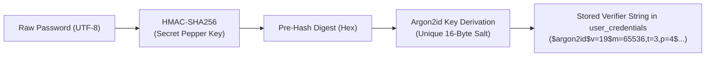

# Password Security, Argon2id & Pepper Secret Management

## 1. Overview & Core Philosophy

This application strictly adheres to OWASP Password Storage and Secrets Management cheat sheets. For application-managed credentials (such as the initial Superadmin and internal accounts), passwords undergo a hardened two-stage cryptographic pipeline:

1. **HMAC-SHA256 Pepper Pre-Hashing**: The password is pre-hashed using a high-entropy secret pepper key stored strictly outside PostgreSQL.
2. **Argon2id Verification**: The pre-hashed digest is verified using Argon2id with unique, random 16-byte cryptographic salts and hardened OWASP work factors.



## 2. Mandatory Hashing Strategy

1. **Input Isolation**: Plaintext passwords enter exclusively through secure server-side boundaries (`server-only`).
2. **Pepper Resolution**: The active pepper is resolved from environment secrets (`PASSWORD_PEPPER_ACTIVE_VERSION` and `PASSWORD_PEPPER_<VERSION>`).
3. **HMAC Pre-Hash**: Computes `HMAC-SHA256(pepper, password)`.
4. **Argon2id Verifier**: Generated using:
   - Memory Cost: `65,536 KiB` (64 MiB)
   - Time Cost: `3 iterations`
   - Parallelism: `4 threads`
   - Salt: 16 cryptographically secure random bytes
5. **Storage**: The PHC verifier string is persisted in `user_credentials.password_hash`, along with `pepper_version` (e.g. `"v1"`).
6. **Zero Leakage**: Plaintext passwords, HMAC intermediate values, and raw pepper keys are never logged, stored in PostgreSQL, or returned to clients.

## 3. Secret Pepper Management & Rotation

### Environment Variables

| Variable                         | Description                                                    | Example                |
| -------------------------------- | -------------------------------------------------------------- | ---------------------- |
| `PASSWORD_PEPPER_ACTIVE_VERSION` | Currently active pepper version identifier for new credentials | `v1`                   |
| `PASSWORD_PEPPER_V1`             | High-entropy 32-byte secret key for version 1                  | `openssl rand -hex 32` |
| `PASSWORD_PEPPER_V2`             | Rotated secret key for version 2 (during rotation)             | `openssl rand -hex 32` |

### Security Safeguards

- **Zero Database Persistence**: The pepper secret key is NEVER stored in PostgreSQL. If the database is compromised, password hashes cannot be brute-forced offline without the external pepper key.
- **Fail Closed**: In production (`NODE_ENV === 'production'`), any missing pepper key immediately terminates the operation with a fatal exception. No silent unpeppered fallback is permitted.
- **Client & Image Exclusion**: Peppers are excluded from client bundles (`NEXT_PUBLIC_` prohibited) and Docker runtime layers.

### Rotation Procedure

1. Introduce a new pepper version:
   ```env
   PASSWORD_PEPPER_ACTIVE_VERSION=v2
   PASSWORD_PEPPER_V1=<existing-secret>
   PASSWORD_PEPPER_V2=<new-high-entropy-secret>
   ```
2. Existing users continue to verify against `user_credentials.pepper_version = 'v1'` using `PASSWORD_PEPPER_V1`.
3. New users or users performing password changes automatically receive hashes under `v2`.
4. Upon successful login, the application re-hashes and upgrades credentials from `v1` to `v2` seamlessly.
5. `PASSWORD_PEPPER_V1` can safely be retired only after all active records in `user_credentials` have been migrated to `v2`.

## 4. Superadmin Bootstrap Command

The bootstrap command provisions the initial Superadmin into PostgreSQL and creates the associated `user_credentials` and `roles` records:

```bash
pnpm auth:bootstrap-superadmin
```

It enforces:

- Hidden interactive password input (minimum 12 characters).
- Rejection of duplicate superadmin provisioning if one already exists.
- Dedicated `user_credentials` entry referencing `users.id` via `BIGINT` foreign key.
- Sanitized audit event logging (`system.bootstrap_superadmin`).
