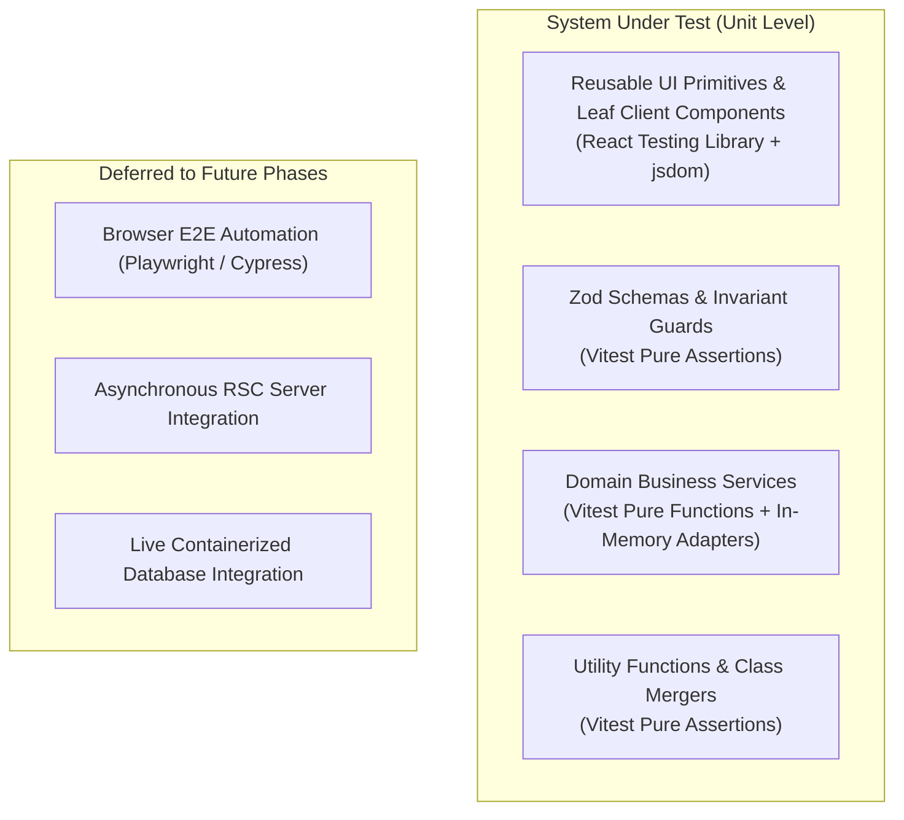

# Testing Strategy: Unit Testing Architecture

## 1. Testing Philosophy & Scope

This scaffold establishes a rigorous **Unit Testing Only** policy for its initial baseline.

Per the official Next.js Vitest guide (`node_modules/next/dist/docs/01-app/02-guides/testing/vitest.md`), React 19 asynchronous Server Components are not natively unit-tested via jsdom rendering. Instead, this architecture isolates domain business logic, data validation, and calculations into pure services and data access layers under `src/server/` and `src/lib/`, allowing fast, deterministic unit test coverage.



## 2. Test Tooling & Environment

- **Runner**: [Vitest](https://vitest.dev) (`vitest@5.1.0`)
- **Environment**: `jsdom` (`jsdom@31.0.0`)
- **DOM Assertions**: `@testing-library/react` (`16.3.3`) and `@testing-library/jest-dom` (`7.0.1`)
- **Path Resolution**: Native Vite path mapping via `resolve: { tsconfigPaths: true }` matching `tsconfig.json` paths (`@/*`)

## 3. Unit Test Execution Scripts

- `pnpm test`: Runs the test suite once in headless mode.
- `pnpm test:watch`: Runs tests in interactive watch mode for rapid TDD.
- `pnpm test:coverage`: Executes tests and outputs v8 code coverage metrics to the terminal and `coverage/`.

## 4. Test Colocation & Structure

Unit tests are colocated alongside their subject code with a `.test.ts` or `.test.tsx` suffix:

```
src/
  lib/
    theme/
      theme-context.tsx
      theme.test.tsx
    utils/
      cn.ts
      cn.test.ts
    validation/
      inquiry.schema.ts
      inquiry.schema.test.ts
  components/
    ui/
      app-input.tsx
      app-input.test.tsx
      app-table.tsx
      app-table.test.tsx
      app-dialog.tsx
      app-dialog.test.tsx
      app-switch.tsx
      app-switch.test.tsx
  server/
    services/
      inquiry.service.ts
      inquiry.service.test.ts
```

## 5. Theme & Component Testing Patterns

1. **Persistent Theme Testing (`src/lib/theme/theme.test.tsx`)**:
   - Verifies default theme fallback (`"light"`).
   - Verifies restoration from `localStorage` (`admin-theme`).
   - Verifies graceful error recovery when `localStorage.setItem` throws (`QuotaExceededError`).
   - Verifies cross-tab synchronization via `window.dispatchEvent(new StorageEvent("storage", ...))`.
   - Verifies DOM `data-theme` attribute synchronization.

2. **UI Component Testing**:
   - `AppInput`: Password visibility toggling, error alerts, helper text linkage.
   - `AppSwitch`: Click toggling, keyboard Enter and Space activation, disabled invariants.
   - `AppTable`: Column sorting, live client filtering, pagination boundary checks, multi-row selection.
   - `AppDialog`: Portal rendering, focus containment, close button trigger, Escape key dismissal.
   - `AppTabs`: Active panel rendering, tab switching on click, ArrowLeft/ArrowRight keyboard navigation.
   - `AppAccordion`: Single mode expansion, multiple mode expansion, toggle open/close, aria-expanded verification.
   - `AppProgress`: Linear progressbar role, aria-valuenow/min/max values, percentage label rendering, indeterminate mode.
   - `AppAvatar`: Remote image rendering, initials fallback, icon fallback, and status dot ARIA indicators.
   - `AppDrawer`: Modal portal mounting, panel header/body/footer rendering, close button event, Escape key dismissal.

## 5. Explicitly Deferred Testing Categories

The following testing tiers are deliberately deferred until production requirements warrant them:

1. **End-to-End (E2E) Browser Tests**: Playwright or Cypress tests verifying full browser page navigations and cookie lifecycles.
2. **Asynchronous Server Component Synthetic Tests**: End-to-end framework-dependent RSC rendering.
3. **Live Network & External Database Integration**: Unit tests must never contact external endpoints or live databases; in-memory adapters and deterministic fixtures are utilized.
